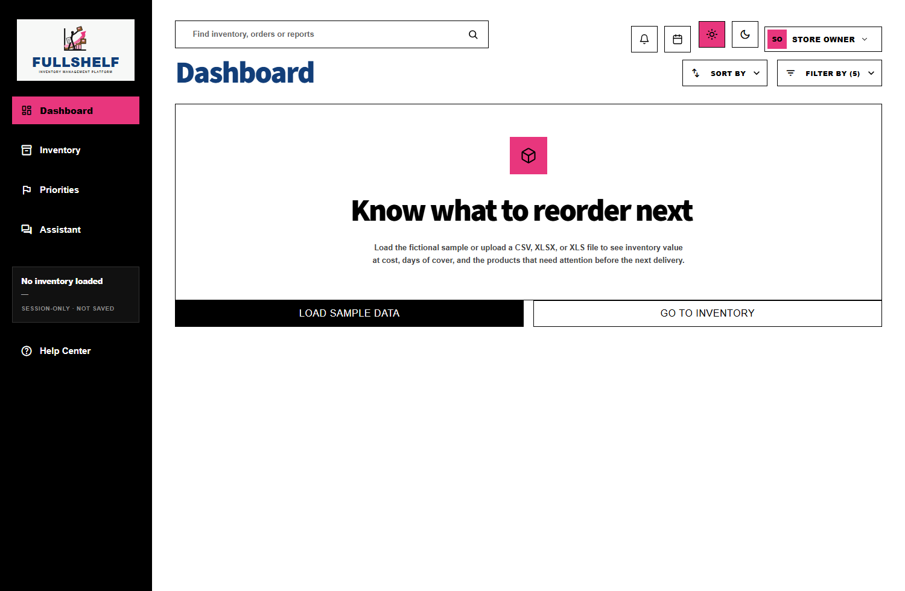

# FullShelf

FullShelf is a small inventory app I built to practise connecting an AI model to a real
Streamlit app. You give it a stock spreadsheet and it shows what is selling out, what is
still healthy, and which products are worth checking first.



## What it does

- Load a CSV or Excel stock file, or try the fictional beauty-and-skincare sample.
- See the total value of your stock, how many days of cover each product has, and a
  ranked list of products that need attention.
- Ask the assistant questions such as “What should I reorder first?” and get a short,
  plain-English answer.
- Switch between light and night mode with the sun and moon buttons in the top bar.

## How it works

The maths is done in Python, not by the AI. Python reads the file, cleans the numbers,
works out the days of cover, reorder point, status, priority and stock value, and builds
the dashboard.

The AI is only used for conversation. When you ask a question, the app lets Gemini choose
one of three small Python functions (inventory summary, product details, or the priority
list), runs that function on the data already loaded, and passes the result back so the
model can explain it. The model never sees the spreadsheet and never does arithmetic.

There is also an optional “Suggest with Gemini” button when a file has unclear column
names. It only runs if you tick the consent box, it only receives the column headings and
up to three sample rows, and it only fills in the dropdowns for you to check. Nothing is
loaded until you confirm.

## Run it on your computer

```powershell
python -m pip install -r requirements.txt
streamlit run app.py
```

The dashboard and all the stock calculations work without any AI setup. To use the
assistant, copy `.env.example` to `.env`, add your own Gemini API key, and install the
Google Gen AI package (it is already in `requirements.txt`).

No key is included in this project, and no key should ever be committed or shared.

## Your spreadsheet

The app needs five columns. The exact names do not matter as much as the values:

```csv
product,current_stock,avg_daily_sales,unit_cost,lead_time_days
Body Lotion,8,1.5,72.50,4
```

If a heading is unclear, FullShelf tries to work it out (for example `Qty on Hand` becomes
`current_stock`). When it cannot be sure, it shows the first few rows and asks you to pick
the right column for each field before loading anything.

Files are limited to 5 MB and 1,000 products. CSV, XLSX and XLS are supported.

## Questions to try

- “I have only 15 minutes tonight. What should I look at first?”
- “Which products might run out before the next delivery?”
- “How much Lip Gloss do I have left?”
- “What will my sales be next month?” (the assistant should explain that it cannot forecast)

## Things to know

- Average daily sales are whatever you type into the file, so they are only a rough guide.
- The reorder point is daily sales multiplied by the supplier lead time. There is no safety
  stock, so treat it as a nudge, not a guarantee.
- Supplier lead times are estimates. Purchase orders, selling price, profit and discounts
  are not part of the app.
- Data lives only in the browser session. Reloading the page clears it.
- The AI can be wrong. It is there to help you read the numbers, not to replace your own
  judgement.

## Tests

```powershell
python -m pytest
```

The tests do not need an API key and do not make paid calls.

## What I would add next

- Better demand estimates from past sales.
- A proper budget planner for restocking.
- A database so data survives a page reload.
