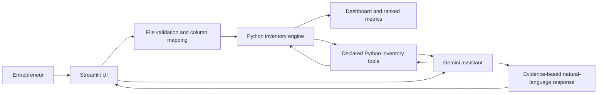

# FullShelf — StockWhisperer

FullShelf is a small, AI-powered inventory decision-support prototype for busy entrepreneurs. It turns a validated CSV or Excel file into a clear stock-risk overview, then lets an owner ask Gemini questions answered with verified Python-calculated inventory data.

## Business problem

Part-time entrepreneurs often fit inventory work around a full-time job and family commitments. Spreadsheet review is easy to postpone, and a small business may not have an analyst to identify which items could run short before a supplier delivery.

## Proposed solution

Upload an inventory CSV, XLSX, or XLS file (or load the fictional South African beauty and skincare sample) to see stock, supplier-cost value, coverage estimates, and deterministically ranked risks. Ask StockWhisperer what needs attention; Gemini selects a Python tool, receives the active session's calculated result, and explains it in plain language.

The interface calls the product **StockWhisperer**, the assistant experience within the FullShelf prototype.

## Technology

- Python 3.11+
- Streamlit
- Pandas
- `openpyxl` for `.xlsx` files and `xlrd` for legacy `.xls` files
- Google Gemini API using the official `google-genai` SDK
- `python-dotenv` and `tzdata`
- pytest

## Architecture



`inventory_engine.py` owns file validation, deterministic column mapping, user-confirmed mapping, and deterministic calculations. `app.py` owns uploads, worksheet and mapping confirmation, session state, and presentation. `gemini_agent.py` binds the current session's analysis to read-only tools, handles the model's function-call loop, and offers a consent-gated mapping-suggestion helper. There is no database or cross-session inventory store.

## How the AI works

The agent declares three tools to Gemini: `get_inventory_summary()`, `get_product_details(product_name)`, and `get_priority_products()`. Gemini chooses a tool based on the question. The application executes that function against the validated analysis in the current Streamlit session, sends the structured tool result back to Gemini, and then displays the model's explanation. Unknown product names return a structured not-found result.

A separate, consent-gated helper can suggest column mappings from headings and a few sample rows. It has no inventory tools, cannot load data, and returns suggestions that the owner must confirm. Python—not the LLM—calculates coverage, lead-time demand, reorder points, stock status, priority, and inventory value. This separation makes business facts reproducible and testable while using the model for conversational interpretation. Unit tests mock the Gemini response; no paid API call is needed to run the test suite.

## Installation (Windows)

Open PowerShell in this project folder:

```powershell
py -3.11 -m venv .venv
.\.venv\Scripts\Activate.ps1
python -m pip install --upgrade pip
python -m pip install -r requirements.txt
```

If PowerShell blocks activation, use the venv executables directly:

```powershell
.\.venv\Scripts\python.exe -m pip install -r requirements.txt
.\.venv\Scripts\python.exe -m streamlit run app.py
```

## Configure Gemini

Create `%LOCALAPPDATA%\FullShelf\.env`. This is the local configuration file in the project root; `.env` is ignored by Git. Keep it out of source control, screenshots, and chat. You can create the directory and open the file from PowerShell:

```powershell
New-Item -ItemType Directory -Force "$env:LOCALAPPDATA\FullShelf"
notepad "$env:LOCALAPPDATA\FullShelf\.env"
```

Copy the contents of the repository's `.env.example` template into that local file, then replace the placeholder with a newly created API key from Google AI Studio. Environment variables already set for your Windows user take precedence over values in the local `.env` file.

```env
GEMINI_API_KEY=your_api_key
GEMINI_MODEL=gemini-3.5-flash-lite
```

The model identifier is configurable because availability varies by account. Change `GEMINI_MODEL` to a Gemini model enabled for your API key that supports function calling (for example, `gemini-flash-latest`). The dashboard and deterministic analysis remain usable without Gemini credentials.

## Run the application

```powershell
streamlit run app.py
```

Load the sample data or upload a file with these five fields:

```csv
product,current_stock,avg_daily_sales,unit_cost,lead_time_days
Body Lotion,8,1.5,72.50,4
```

Column names do not have to match that template exactly. FullShelf accepts `.csv`, `.xlsx`, and `.xls` files, detects the header row, detects common CSV delimiters, and maps aliases such as `Item Description`, `Qty on Hand`, `Avg. Units per Day`, `Cost Price (R)`, and `Supplier Lead Time (Days)` to the five required fields. See [Supported files and column mapping](#supported-files-and-column-mapping).

The sample is fictional and demonstrates healthy items, shortage risks, a product exactly at its reorder point, an out-of-stock product, and products with no recorded demand. Uploads are limited to 5 MB and 1,000 product rows.

The top bar has sun and moon buttons that switch between light and night mode for the current browser session. The night theme only inverts the rendered palette; it does not change data, calculations, or stored files. The sidebar shows the FullShelf logo from `assets/logo.svg` (mark and wordmark), and the interface colours (pink `#E8367D`, deep pink `#C21E56`, navy `#123E79`, tan `#D9A066`, brown `#8B5A2B`, soft pink `#F7A8C4`) are sampled from that artwork.

## Supported files and column mapping

- **Formats:** CSV, XLSX, and XLS. CSV encoding is detected from UTF-8, UTF-16, Windows-1252, or Latin-1.
- **Worksheets:** when a workbook has more than one sheet, choose the sheet that holds the stock table. FullShelf preselects the only sheet that fully matches the schema, and asks when several sheets look like inventory.
- **Header rows:** the header does not have to be the first row. Title or report-date rows above the table are skipped.
- **Delimiters:** comma, semicolon, tab, and pipe are detected. Currency symbols, thousands separators, decimal commas, and unit text such as `12 units` are cleaned before numeric validation.
- **Aliases and fuzzy matching:** headers are lowercased, punctuation and units are stripped, abbreviations are expanded, and aliases are scored. For example, `Stock`, `Qty on Hand`, and `Quantity Available` map to `current_stock`.
- **Ambiguity opens a confirmation step:** if two columns look equally like one field, or the matcher cannot find every field, FullShelf shows the detected header row and asks you to choose a column for each required field. Your choices are validated before anything is loaded.
- **Optional AI suggestions:** with your explicit consent, FullShelf can send only the column headings and up to three sample rows to Gemini for suggested mappings. Suggestions are prefilled for review, never applied automatically, and Python still performs the final mapping, validation, and every calculation.
- **Units and periods are checked:** a `Weekly Sales` column is not treated as average daily sales, and `Lead Time (Weeks)` is not treated as days. The error asks you to convert the value and rename the column.
- **Value columns are blocked:** `Stock Value` is not used as units on hand, and `Total Cost` is not used as a unit cost.
- **Ignored columns and total rows:** unused columns are listed in the mapping footnote. A trailing row labelled `TOTAL`, `Grand Total`, or `Subtotal` is skipped.
- **No LLM parsing:** deterministic matching, user-confirmed mapping, validation, and all calculations run in Python. The full file is never sent to Gemini.

Mapping metadata is available on the returned DataFrame as `column_mapping`, `mapping_details`, `ignored_columns`, `sheet_name`, `header_row`, and `skipped_total_rows`.

### Mapping confirmation and consent

When the deterministic mapper cannot finish safely, the import card shows the detected header row, a short data preview, and one dropdown per required field. Selecting **Use this mapping** validates the choices and then loads the inventory; unsafe choices such as a stock-value column for `current_stock` are still rejected. **Cancel** discards the pending upload.

**Suggest with Gemini** stays disabled until the consent checkbox is ticked. That action sends only the column headings and at most three sample rows, clipped to a short length. The response is filtered to the exact supplied headings and the five field names, so invented columns are discarded. Suggestions only change the preselected dropdowns; nothing is loaded until you confirm, and Python performs the final mapping, validation, and every calculation.

## Run tests

```powershell
python -m pytest
```

The ordinary test suite checks the required R2,109 regression fixture, coverage and statuses, reorder/zero-demand/out-of-stock behavior, priority order, input validation, renamed and reordered headers, title rows, semicolon and Windows-encoded CSV files, currency cleaning, XLSX workbooks, worksheet selection, ambiguous mappings, mapping confirmation, consent-gated Gemini mapping suggestions, ignored columns, skipped total rows, light/night mode switching, logo rendering, product lookup, and mocked Gemini function-call round trips. It does not need API credentials and does not make paid provider calls.

An optional live integration test checks that Gemini calls `get_product_details` and answers with the sample product's known stock count. It makes a real provider request and is skipped unless explicitly enabled:

```powershell
$env:FULLSHELF_RUN_LIVE_GEMINI = "1"
python -m pytest -q tests/test_gemini_live.py
Remove-Item Env:\FULLSHELF_RUN_LIVE_GEMINI
```

Configure a valid key and a function-calling model in `%LOCALAPPDATA%\FullShelf\.env` before opting in. The repository also includes a GitHub Actions workflow at `.github/workflows/tests.yml`; it runs the ordinary, credential-free test suite on pushes and pull requests. A remote CI run is only available after this folder is pushed to a GitHub repository.

## Demo questions

- “I have only 15 minutes tonight. What inventory issues should I prioritise?”
- “Which products might run out before delivery?”
- “How much stock do I have left for Lip Gloss?”
- “I only have R800 to spend. What should I consider?”
- “What will my sales be next month?” (The assistant should explain the forecasting limitation.)

## Assumptions and limitations

- Average daily demand is user-supplied and is only a rough estimate for relatively regular demand; seasonal, weekend-only, or intermittent sales are not modelled.
- Reorder point equals average daily demand multiplied by estimated supplier lead time. Safety stock is zero, so this is not a robust buffer.
- Supplier lead time is not guaranteed. Outstanding purchase orders, minimum order quantities, selling prices, margin, and profitability are not represented.
- Priority is a deterministic urgency heuristic, not an optimised purchasing strategy. Budget-based quantities are not calculated.
- There is no advanced forecasting, automatic purchasing, real-time POS connection, or persistent storage. Session data can disappear after a browser reload.
- “Uploaded at” is the time the file entered the app session; it does not prove when inventory was counted. Timestamps display in Africa/Johannesburg time.
- AI output supports, but does not replace, human review.

## Engineering decisions

Deterministic calculations run in Python so that the dashboard and AI tools use the same validated facts. The model is useful for selecting the relevant tool and explaining results, but it is not trusted to perform arithmetic, invent missing records, or optimise purchases. Explicit tool responses keep the data path inspectable and testable.

## Future improvements (not implemented)

- Historical sales integration and better demand estimation.
- Validated budget-constrained purchasing optimisation.
- Persistent database and multi-business support.
- Scheduled inventory briefings and supplier integrations.
- Better forecasting that accounts for seasonality and uncertainty.
